## Cuff Pressure Sensor

| **Solution**                                                                                                                                                                                      | **Pros**                                                                                                                                    | **Cons**                                                                                            |
| ------------------------------------------------------------------------------------------------------------------------------------------------------------------------------------------------- | ------------------------------------------------------------------------------------------------------------------------------------------- | --------------------------------------------------------------------------------------------------- |
| 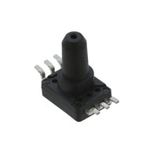 Option 1.  Aratas (Omron) 2SMPP-03 MEMS Gauge Blood Pressure Sensor $8.36/each [link to product](https://www.digikey.com/en/products/detail/aratas-formerly-omron-components/2SMPP-03/3671590) | \* Inexpensive ($8.36), keeping total subsystem cost well under the $60 course budget \* Unamplified piezoresistive Wheatstone bridge output (0 to 42 mV) directly satisfies the EGR 304 Permitted Analog Sensor requirement for custom amplification and active filtering \* Purpose-built for medical blood pressure cuffs (0 to 50 kPa / 0 to 375 mmHg gauge range) with a built-in tube port | \* Requires a 3-op-amp instrumentation amplifier stage in addition to an active band-pass filter \* Uses surface mounting instead of through-hole pins |
| 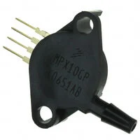 \* Option 2.  \* STMicroelectronics MPX2050GP Unamplified Bridge Pressure Sensor  \* $23.87/each  \* [Link to product](https://www.digikey.com/en/products/detail/stmicroelectronics/MPX2050GP/410891) | \* Unamplified Wheatstone bridge (0 to 40 mV output) satisfies the EGR 304 requirement for a custom non-trivial amplifier and filter circuit  \* Through-hole 4-SIP package with a 4.93mm barbed port is easy to solder on a Peralta PCB   \* Covers the ideal 0 to 50 kPa (0 to 375 mmHg) vented gauge pressure range | * Nearly 3x more expensive than the Omron 2SMPP-03 ($23.87 vs. $8.36)  \* Requires 10V, so 5V rail reduces output to 20 mV |
| 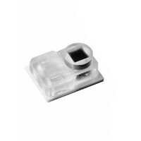 \* Option 3.  \* Amphenol Advanced Sensors (NovaSensor) NPC-120T  \* $8.18/each  \* [Link to product](https://www.digikey.com/en/products/detail/amphenol-advanced-sensors/NPC-120T/6044069) | \* Inexpensive ($8.18)  \* Very high maximum pressure (125PSI) minimizes chance of sensor breaking under unanticipated load   \* Robust voltage input (1-10V) | * Small SMD component may be difficult to solder on PCB  \* No built-in tube port will make attaching tubes difficult |

*Table 1: Cuff Pressure Sensor component selection*

**Choice:** Option 3: Amphenol Advanced Sensors (NovaSensor) NPC-120T

**Rationale:** Option 2 is much too expensive, and between Option 1 and Option 3, Option 3 is more robust while also being slightly cheaper.

---

## Operational Amplifier (Op Amp)

| **Solution**                                                                                                                                                                                      | **Pros**                                                                                                                                    | **Cons**                                                                                            |
| ------------------------------------------------------------------------------------------------------------------------------------------------------------------------------------------------- | ------------------------------------------------------------------------------------------------------------------------------------------- | --------------------------------------------------------------------------------------------------- |
|  Option 1.  Microchip MCP6004-I/P Quad Rail-to-Rail Op Amp (14-PDIP) $0.60/each [link to product](https://www.digikey.com/en/products/detail/microchip-technology/MCP6004-I-P/523060) | \* Inexpensive ($0.60) and also available on hand \* Houses 4 rail-to-rail op-amps in a single through-hole 14-PDIP package, allowing a 3-op-amp instrumentation amplifier and a 4th-stage active band-pass filter on one IC \* Swings across the full 0V to 5V range on our single 5V regulated rail with 1 MHz gain-bandwidth product \* Already proven to work | \* 6.0V absolute maximum supply rating means it must strictly be powered from the regulated 5V rail, never the 9V rail \* 14-pin DIP footprint takes slightly more PCB space than an 8-pin DIP |
|  \* Option 2.  \* Microchip MCP6002-I/P Dual Rail-to-Rail Op Amp (8-PDIP)  \* $0.45/each  \* [Link to product](https://www.digikey.com/en/products/detail/microchip-technology/MCP6002-I-P/500875) | \* Compact 8-pin PDIP through-hole package is very easy to breadboard and solder  \* Full 0V to 5V rail-to-rail input and output swing maximizes PIC18F57Q43 ADC resolution   \* Ultra-low 100 uA quiescent current per channel | * Only contains 2 op-amp channels, requiring two separate chips if building a 3-op-amp differential instrumentation amplifier plus an active filter stage  \* Maximum supply voltage is limited to 6.0V |
|  \* Option 3.  \* Texas Instruments LM358P Dual General-Purpose Op Amp (8-PDIP)  \* $0.33/each  \* [Link to product](https://www.digikey.com/en/products/detail/texas-instruments/LM358P/277042) | \* Wide 3V to 30V supply voltage range tolerates either the 5V or 9V power rail without damage  \* Very inexpensive ($0.33) in a standard 8-PDIP through-hole package   \* Low 500 uA supply current | * Not rail-to-rail output: saturates at roughly 3.5V when powered from a 5V rail, losing 30% of the PIC18F57Q43 ADC dynamic range  \* Contains only 2 channels and exhibits higher input bias current (20 nA vs. 1 pA CMOS) |

*Table 2: Operational Amplifier component selection*

**Choice:** Option 1: Microchip MCP6004-I/P Quad Rail-to-Rail Op Amp (14-PDIP)

**Rationale:** Option 1 is already familiar and known to function, and the additional Op Amps in the package allow for additional signal processing if needed.

---

## Character LCD Display

| **Solution**                                                                                                                                                                                      | **Pros**                                                                                                                                    | **Cons**                                                                                            |
| ------------------------------------------------------------------------------------------------------------------------------------------------------------------------------------------------- | ------------------------------------------------------------------------------------------------------------------------------------------- | --------------------------------------------------------------------------------------------------- |
| 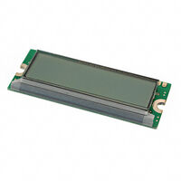 Option 1.  Lumex LCM-S01602DTR/M 16x2 Character LCD Module (5V Parallel) $7.44/each [link to product](https://www.digikey.com/en/products/detail/lumex-opto-components-inc/LCM-S01602DTR-M/469805) | \* Inexpensive ($7.44) bare LCD module that complies with the EGR 304 ban on commercial breakout/daughterboards \* Uses a standard 5V parallel GPIO interface, avoiding I2C and SPI protocols that are not covered in EGR 304 \* Transflective yellow-green LED backlight is easy to read under bright classroom lighting and draws only ~15-25 mA | \* Requires 6 digital GPIO pins on the PIC18F57Q43 in 4-bit parallel mode \* Requires an external 10k Ohm contrast trimmer potentiometer on the PCB |
| 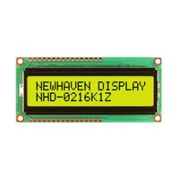 \* Option 2.  \* Newhaven Display NHD-0216K1Z-FL-YBW 16x2 Character LCD  \* $7.83/each  \* [Link to product](https://www.digikey.com/en/products/detail/newhaven-display-intl/NHD-0216K1Z-FL-YBW/1701171) | \* Direct 5V GPIO parallel interface (ST7066U controller) with complete mechanical and timing datasheets on DigiKey  \* High-contrast STN transflective display with yellow-green backlight   \* Standard 80mm x 36mm footprint fits within the 100mm x 100mm PCB limit | * Slightly more expensive ($7.83 vs. $7.44) for identical 16x2 character functionality  \* Also requires 6 GPIO pins and an external contrast resistor divider or potentiometer |
| 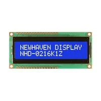 \* Option 3.  \* Newhaven Display NHD-0216K1Z-NSW-BBW-L 16x2 White-on-Blue LCD  \* $7.44/each  \* [Link to product](https://www.digikey.com/en/products/detail/newhaven-display-intl/NHD-0216K1Z-NSW-BBW-L/1701179) | \* Same low $7.44 price point and 5V parallel GPIO compatibility  \* Crisp white text on a blue background provides modern medical aesthetics   \* No daughterboard or serial backpack required | * Transmissive mode requires the LED backlight to be powered at all times in order to read the characters  \* Uses 6 digital I/O pins on the microcontroller |

*Table 3: Display component selection*

**Choice:** Option 2: Newhaven Display NHD-0216K1Z-FL-YBW 16x2 Character LCD

**Rationale:** Option 1 is out of stock, and between Option 2 and Option 3, Option 2 is transflective, meaning it is more visible in
higher light conditions.

---

## H-Bridge Actuator Driver

| **Solution**                                                                                                                                                                                      | **Pros**                                                                                                                                    | **Cons**                                                                                            |
| ------------------------------------------------------------------------------------------------------------------------------------------------------------------------------------------------- | ------------------------------------------------------------------------------------------------------------------------------------------- | --------------------------------------------------------------------------------------------------- |
| 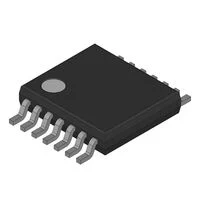 Option 1.  Fairchild Semiconductor FAN8100N Dual H-Bridge (12-DIP with heat pads) $1.16/each [link to product](https://www.digikey.com/en/products/detail/fairchild-semiconductor/FAN8100N/11558200) | \* Directly satisfies the EGR 304 Permitted Actuator requirement for a complex motor driver IC in the L293D family \* 1.5A max current output \* Already proven to work | \* Bipolar Darlington outputs drop ~1.4V to 2.0V internally (though this safely steps our 9V rail down toward the 6V actuator rating) \* Draws ~35 mA quiescent current on the logic and load rails |
|  \* Option 2.  \* STMicroelectronics L293D Push-Pull Four-Channel Driver IC (16-PDIP)  \* $6.61/each  \* [Link to product](https://www.st.com/en/motor-drivers/l293d.html) | \* Explicitly named in the EGR 304 syllabus as an approved complex motor driver IC  \* Can be requested as a free sample directly from STMicroelectronics | * Lower continuous output current rating (600 mA per channel), leaving less thermal margin for a 500 mA air pump  \* Higher unit retail price ($6.61 vs. $4.39) |
| 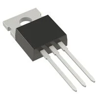 \* Option 3.  \* Custom Dual Low-Side Switch using 2x Infineon IRLZ44NPBF Logic N-MOSFETs  \* $3.08/each ($6.16 for 2)  \* [Link to product](https://www.digikey.com/en/products/detail/infineon-technologies/IRLZ44NPBF/811808) | \* Very low 22 mOhm on-resistance in a rugged TO-220 through-hole package  \* True 5V logic-level gate drive from PIC18F57Q43 PWM pins   \* High 47A current rating never overheats under pump loads | * Does not use a complex motor driver IC as recommended in the Permitted Actuators guidelines  \* Requires external flyback diodes and gate resistors on the PCB, and passes the full 9V supply to 6V actuators if PWM is set to 100% |

*Table 4: H-Bridge Motor Driver component selection*

**Choice:** Option 1: Fairchild Semiconductor FAN8100N Dual H-Bridge

**Rationale:** Option 1 is the lowest cost and is already familiar and proven to work.

---

## DC Air Pump

| **Solution**                                                                                                                                                                                      | **Pros**                                                                                                                                    | **Cons**                                                                                            |
| ------------------------------------------------------------------------------------------------------------------------------------------------------------------------------------------------- | ------------------------------------------------------------------------------------------------------------------------------------------- | --------------------------------------------------------------------------------------------------- |
| 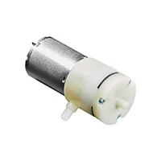 Option 1.  Adafruit 4699 (ZR370-02PM) 4.5V-6V DC Diaphragm Air Pump (2.5 LPM) $7.95/each [link to product](https://www.digikey.com/en/products/detail/adafruit-industries-llc/4699/13170954) | \* Purpose-built 370-size sphygmomanometer diaphragm pump delivering 2.5 L/min flow and >400 mmHg stall pressure \* Easily overcomes a constant passive bleed orifice to inflate an adult cuff to 180 mmHg in ~10-15 seconds \* Stocked on DigiKey with full mechanical and electrical specifications ($7.95) | \* Rated for 4.5V-6V nominal, requiring PWM duty-cycle limiting (~75-80%) when driven from our 9V H-Bridge rail \* Draws ~500 mA peak current during inflation |
| 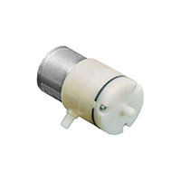 \* Option 2.  \* Adafruit 4700 Mini DC Air Pump and Vacuum Motor (0.5 LPM)  \* $6.95/each  \* [Link to product](https://www.digikey.com/en/products/detail/adafruit-industries-llc/4700/13170956) | \* Lower current draw (~300 mA) reduces load on the 9V power supply  \* Ultra-compact footprint and $1.00 lower cost ($6.95)   \* Includes barbed ports for silicone tubing | * Low 0.5 L/min flow rate is 5x slower than Option 1 and struggles to reach 180 mmHg when fighting a constant bleed orifice  \* Smaller motor wears out faster under high back-pressure |
| 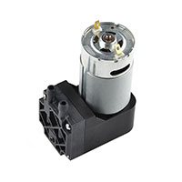 \* Option 3.  \* SparkFun ROB-10398 12V DC Vacuum and Air Pump  \* $26.85/each  \* [Link to product](https://www.digikey.com/en/products/detail/sparkfun-electronics/10398/5684377) | \* High flow rate and 16 inHg (~406 mmHg) pressure capability  \* 12V motor rating cannot be over-volted by a 9V supply   \* Full datasheet available on DigiKey | * Over 3x more expensive ($26.85 vs. $7.95), which would push our BOM close to the $60 budget limit  \* Under-driven on a 9V supply (~7.2V after H-Bridge drop), operating below its rated speed |

*Table 5: DC Air Pump component selection*

**Choice:** Option 1: Adafruit 4699 (ZR370-02PM) 4.5V-6V DC Diaphragm Air Pump

**Rationale:** Option 1 is the cheapest option that still has the required flow rate.

---

## Solenoid Air Valve

| **Solution**                                                                                                                                                                                      | **Pros**                                                                                                                                    | **Cons**                                                                                            |
| ------------------------------------------------------------------------------------------------------------------------------------------------------------------------------------------------- | ------------------------------------------------------------------------------------------------------------------------------------------- | --------------------------------------------------------------------------------------------------- |
| 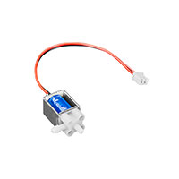 Option 1.  Adafruit 4663 (FA0520E) 6V 3-Port Solenoid Air Release Valve $2.95/each [link to product](https://www.digikey.com/en/products/detail/adafruit-industries-llc/4663/13170960) | \* Inexpensive ($2.95) miniature 3-port medical cuff valve with full specifications on DigiKey \* Fail-safe Normally Open (NO) exhaust path automatically vents cuff pressure if power is lost or measurement completes \* Zero minimum pressure differential required to actuate from 0 to 350 mmHg | \* 6V coil rating (~300-350 mA) requires ~75% PWM duty cycle when powered from our 9V H-Bridge rail \* Plastic barbed ports require gentle handling during assembly |
| 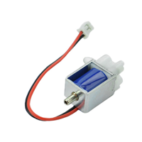 \* Option 2.  \* DFRobot DFR0866 6V 2-Position 3-Way Air Solenoid Valve  \* $4.00/each  \* [Link to product](https://www.digikey.com/en/products/detail/dfrobot/DFR0866/15283079) | \* Identical 3-port pneumatic switching behavior suitable for cuff exhaust control  \* Low coil current (~220-350 mA at 6V DC)   \* Stocked directly by DigiKey | * Costs 35% more ($4.00 vs. $2.95) than Option 1 for the same form factor and coil rating  \* Shorter wire leads require extension to reach the PCB terminal block |
| 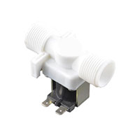 \* Option 3.  \* SparkFun ROB-10456 12V 2-Way Normally Closed Solenoid Valve  \* $9.62/each  \* [Link to product](https://www.digikey.com/en/products/detail/sparkfun-electronics/10456/5684378) | \* Rugged valve body with standard 0.25-inch quick-disconnect spade terminals  \* Rated up to 116 PSI maximum pressure   \* Cannot be over-volted by a 9V rail | * Unsafe Normally Closed (NC) configuration traps pressure in the cuff if power fails  \* Pilot-operated liquid diaphragm requires at least 2.9 PSI (150 mmHg) pressure differential just to open and uses bulky 3/4-inch NPT pipe threads |

*Table 6: Solenoid Air Valve component selection*

**Choice:** Option 1: Adafruit 4663 (FA0520E) 6V 3-Port Solenoid Air Release Valve

**Rationale:** Option 1 is the cheapest option that is also normally open (NO).

---

## 5V 1.5A Linear Voltage Regulator

| **Solution**                                                                                                                                                                                      | **Pros**                                                                                                                                    | **Cons**                                                                                            |
| ------------------------------------------------------------------------------------------------------------------------------------------------------------------------------------------------- | ------------------------------------------------------------------------------------------------------------------------------------------- | --------------------------------------------------------------------------------------------------- |
|  Option 1.  STMicroelectronics L7805CV 5V 1.5A Fixed Linear Voltage Regulator $0.55/each [link to product](https://www.digikey.com/en/products/detail/stmicroelectronics/L7805CV/585964) | \* Inexpensive ($0.55) and satisfies the EGR 304 requirement for a linear voltage regulator \* Fixed 5.0V output at up to 1.5A requires only two decoupling capacitors and eliminates the risk of feedback resistor errors over-volting 5V ICs \* Through-hole TO-220-3 package with internal thermal overload and short-circuit protection | \* ~2.0V dropout voltage requires an input supply of at least 7.0V (easily met by our 9V wall adapter) \* Dissipates (9V - 5V) * I_load as heat, though our 5V rail draws ~107 mA (~0.43W heat, no heatsink needed) |
|  \* Option 2.  \* Texas Instruments LM2940CT-5.0/NOPB 5V 1.0A LDO Linear Regulator  \* $1.09/each  \* [Link to product](https://www.digikey.com/en/products/detail/texas-instruments/LM2940CT-5-0-NOPB/32575) | \* Low dropout voltage (0.5V typical) maintains a stable 5V rail even if the input sags to 6.0V  \* Includes reverse-battery protection in a standard TO-220-3 package   \* Easily handles our ~134 mA (with 25% margin) 5V rail load | * Lower maximum output current rating (1.0A vs. 1.5A on the L7805CV) and currently backordered on DigiKey  \* Requires a >=22 uF output capacitor within a strict ESR window (0.1 to 5 Ohm) to prevent oscillation |
|  \* Option 3.  \* Texas Instruments LM317T/NOPB 1.25V-37V 1.5A Adjustable Linear Regulator  \* $1.29/each  \* [Link to product](https://www.digikey.com/en/products/detail/texas-instruments/LM317T-NOPB/6178) | \* Matches the 1.5A output current capability in a through-hole TO-220-3 package  \* Output voltage can be tuned with two external resistors   \* Built-in current limiting and thermal overload protection | * Requires two external precision resistors to set 5.0V; a cold solder joint on the ADJ pin could cause the output to jump toward 9V and destroy the PIC18F57Q43 and MCP6004  \* Costs more than twice as much as the fixed L7805CV ($1.29 vs. $0.55) |

*Table 7: 5V Linear Voltage Regulator component selection*

**Choice:** Option 1: STMicroelectronics L7805CV 5V 1.5A Fixed Linear Voltage Regulator

**Rationale:** Option 1 is the cheapest and meets all requirements.

---

## 9V External Power Supply

| **Solution**                                                                                                                                                                                      | **Pros**                                                                                                                                    | **Cons**                                                                                            |
| ------------------------------------------------------------------------------------------------------------------------------------------------------------------------------------------------- | ------------------------------------------------------------------------------------------------------------------------------------------- | --------------------------------------------------------------------------------------------------- |
|  Option 1.  Bel Power Solutions SMI18-9-V-P5 9V 2.0A (18W) AC/DC Wall Adapter $23.11/each [link to product](https://www.digikey.com/en/products/detail/bel-power-solutions/SMI18-9-V-P5/5417773) | \* Supplies up to 2,000 mA at 9V DC, which is more than enough  \* Standard 2.1mm x 5.5mm center-positive barrel plug connects directly to a PCB barrel jack \* Complete UL/CE safety certifications and DigiKey datasheet | \* Costs $23.11  \* Requires connection to a 120V AC wall outlet |
| 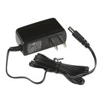 \* Option 2.  \* SparkFun TOL-15314 9V 650mA AC/DC Wall Adapter  \* $9.25/each  \* [Link to product](https://www.digikey.com/en/products/detail/sparkfun-electronics/15314/10244129) | \* Affordable ($9.25) with a standard 2.1mm x 5.5mm center-positive barrel plug  \* Lightweight and compact wall plug   \* Documented specifications on DigiKey and SparkFun | * Fails the Power Budget requirement  \* Insufficient current headroom for motor startup spikes |
| 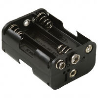 \* Option 3.  \* MPD BH26AASF 6xAA Alkaline Battery Holder (9V Nominal)  \* $1.23/each (plus 6x AA cells)  \* [Link to product](https://www.digikey.com/en/products/detail/mpd-memory-protection-devices/BH26AASF/470766) | \* Very inexpensive hardware ($1.23) allowing untethered portable operation  \* Provides ~2,500 mAh capacity with 6 fresh 1.5V AA alkaline batteries   \* Includes datasheet and mechanical drawing on DigiKey | * Voltage sags below the 7.0V minimum dropout threshold of the L7805CV regulator as AA cells discharge under a ~1A pump/solenoid load  \* Requires batteries to be replaced frequently |

*Table 8: 9V External Power Supply component selection*

**Choice:** Option 1: Bel Power Solutions SMI18-9-V-P5 9V 2.0A (18W) AC/DC Wall Adapter

**Rationale:** Option 1 provides enough power to have a safety margin.

# Pin Assignments

These are all the pins assigned on my microcontroller for all of the above components as well as debugging and communication components.

| Pin | Subsystem | MCC setting | Connects to |
| :--- | :--- | :--- | :--- |
| **RD1** | Buttons | Digital input | SW1 push button, 10k hardware pull-down (R13) with RC debounce (C6), active high |
| **RD2** | Debug | Digital output, start low | D1 debug LED (Blue), 330Ω current-limiting resistor (R12), active high |
| **RA0** | Pressure Sensor | Analog input (ADC) | `Amplified_Pressure` (Instrumentation Op-Amp U5C DC output) |
| **RA1** | Pressure Sensor | Analog input (ADC) | `Pressure_Signal` (Band-pass filter Op-Amp U5D AC output) |
| **RB0** | Pump Control | Digital output, start low | `Pump_In` (FAN8100N U3 Pin 11 `FORWARDA`), active high |
| **RB3** | Valve Control | Digital output, start low | `Valve_In` (FAN8100N U3 Pin 2 `FORWARDB`), active high |
| **RD6** | LCD | Digital output, start low | LCD RS (Pin 4) |
| **RD5** | LCD | Digital output, start low | LCD E (Pin 6) |
| **RB5** | LCD | Digital output, start low | LCD DB4 (Pin 11) |
| **RF7** | LCD | Digital output, start low | LCD DB5 (Pin 12) |
| **RF6** | LCD | Digital output, start low | LCD DB6 (Pin 13) |
| **RF5** | LCD | Digital output, start low | LCD DB7 (Pin 14) |
| **RA2** | External Comm | Analog input / Analog output | J2 External Board Connector (Pin 6) |
| **RA5** | External Comm | Analog input / Analog output | J2 External Board Connector (Pin 7) |
| **GND** | Ground | | Board `Earth` net (Pins 15, 24, 33, 42, 52, and J2 Pin 8) |