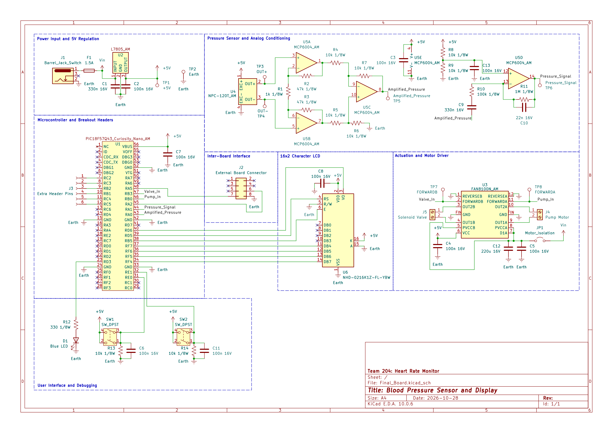

## Overview

This schematic is designed to support measuring blood pressure and displaying information. 

The board runs off a 9V power supply which is stepped down to 5V via a linear voltage regulator. The pressure sensor takes 5V and outputs a weak analog signal which is run through an instrumentation amplifier to get general pressure. Then, that signal is run through another low pass filter and amplifier to get smaller pressure oscillations to be read as blood pressure.

The two actuators are run off a dual H-bridge. Information is sent and received over two analog pins and then displayed on a 16x2 character LCD.
An LED and two push buttons are included for debugging/user input.

{style width:"350" height:"300;"}
**Figure 1:** The board schematic.

## Resouces

The schematic as a PDF download is available [*here*](Final_Board.pdf), and the Zip folder of the KiCAD project [*here*](Final_Board_ALL.zip).