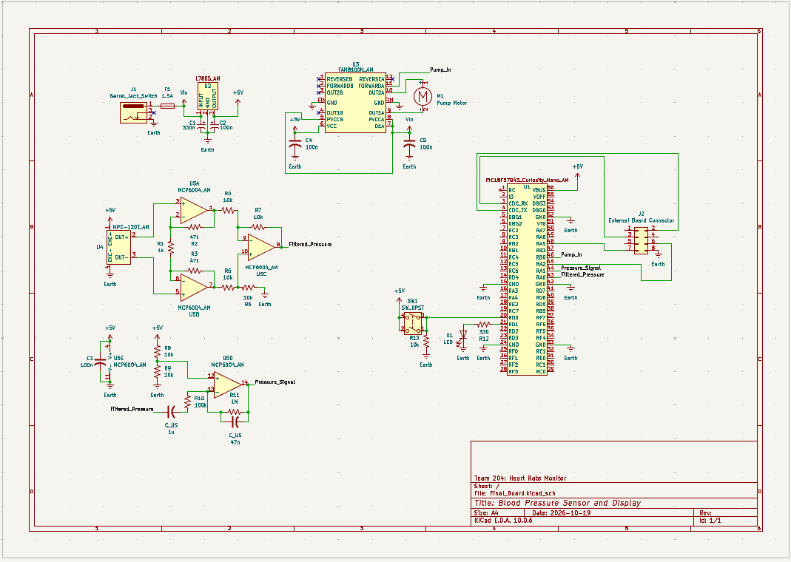

## Overview

This schematic is design to support measuring blood pressure and displaying information.

{style width:"350" height:"300;"}
**Figure 1:** The board schematic.

## Resouces

The schematic as a PDF download is available [*here*](Final_Board.pdf), and the Zip folder of the project [*here*](Final_Board_ALL.zip).