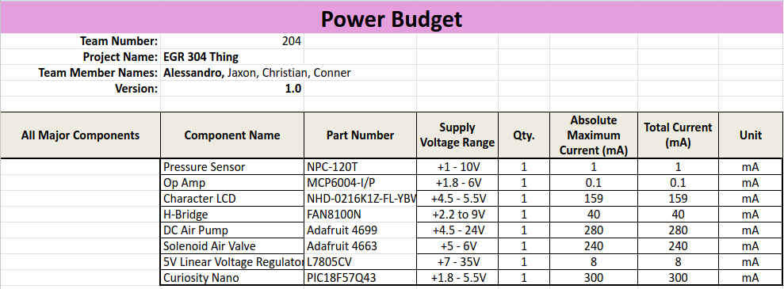
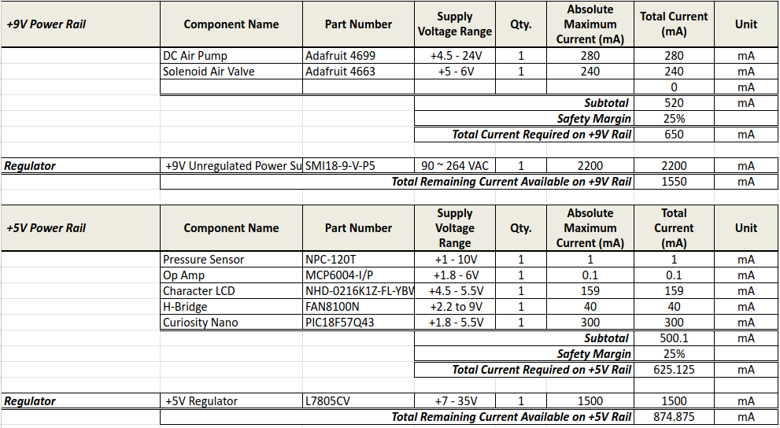
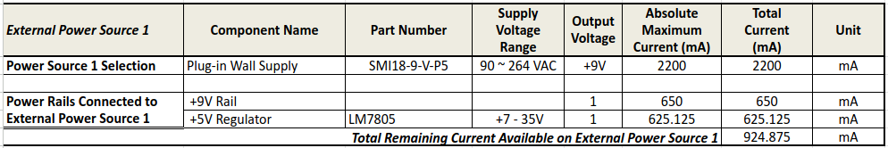

## Overview
Since this project involves two separate actuators along with a sensor and a display, making a power budget is essential to make sure there is enough power
for all the components to operate safely.

{style width:"350" height:"300;"}

{style width:"350" height:"300;"}

{style width:"350" height:"300;"}

## Conclusions

From the power budget, it was determined that the rated current draw of the two actuators is fairly low, leaving plenty of headroom with the selected power supply and voltage regulator.

## Resouces

The power budget as a PDF download is available [*here*](Power_Budget.pdf), and a Microsoft Excel Sheet [*here*](Power_Budget.zip).