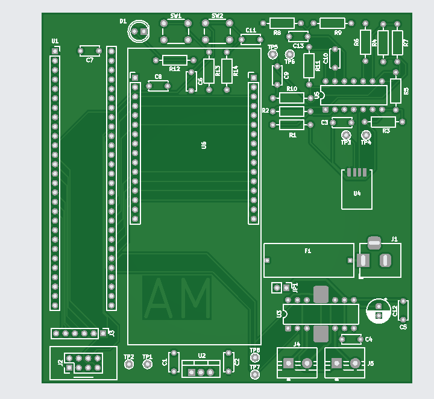
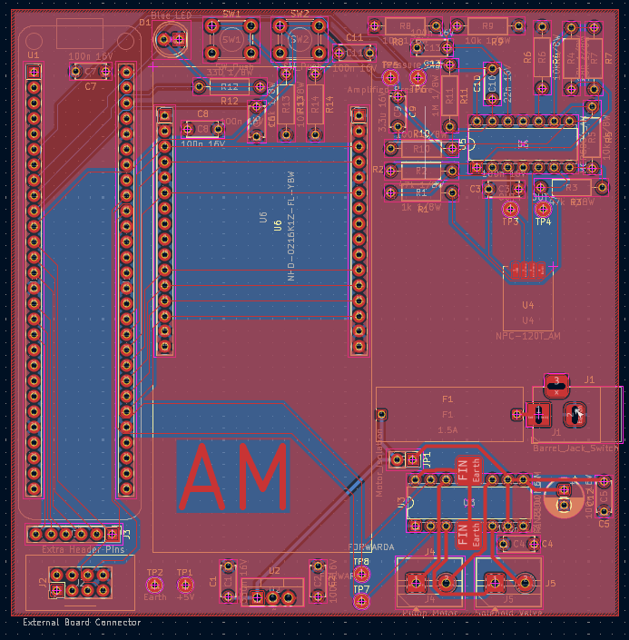

## Overview

Below is the finished PCB design for the project.

{style width:"350" height:"300;"}
**Figure 1:** A render of the PCB design.

{style width:"350" height:"300;"}
**Figure 2:** The PCB design.

## Resouces

The PCB as a PDF download is available [*here*](Final_Board_PCB.pdf), and the Zip folder of the KiCAD project [*here*](Final_Board_ALL.zip).